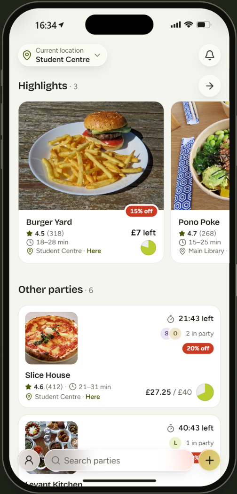
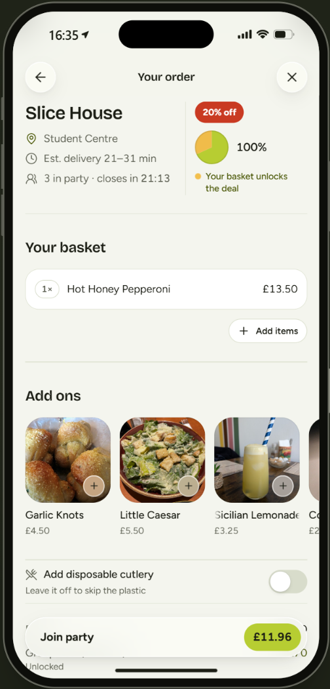
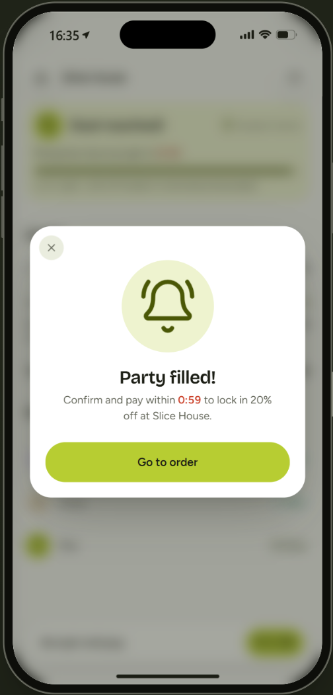
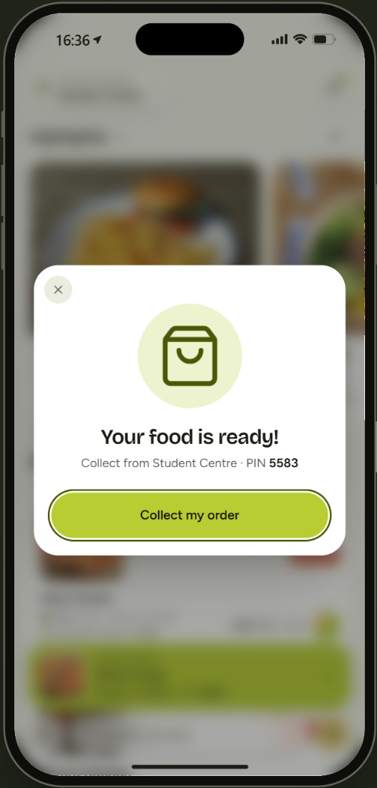

# Bulk

**Order together. Unlock bulk deals. Share one delivery.**

Bulk is group food ordering for students who'd otherwise eat alone. Ordering by yourself is the most expensive way to get delivery: fees pile onto small orders, and restaurant deals like "30% off over £20" never apply to one person's dinner. Bulk puts you in a party with students nearby who want the same restaurant. Together you unlock the deal and split one delivery fee, while each person orders and pays only for their own food. Everyone collects their own labelled bag with a personal PIN

  
  
  
  

**Product Demo:** https://bulk-theta.vercel.app/

**Website:** https://bulk-landing-red.vercel.app/

## The problem

Ordering alone is the most expensive way to get food delivered, and students do it all the time.

- **Fees stack up on small orders.** On a £12 Uber Eats order, fees add about **£3.93**: a 12% service fee (£1.44) plus delivery (£2.49 in our example). Under £10 there's also a £0.99 small-order fee, so a £9 order pays **£4.56** in fees, about half the food again.
- **Deals check one basket.** Restaurant offers like Deliveroo's Midweek Special (30% off orders of £20 or more) never apply to one student's £12 order.
- **Students feel it.** 63% of students skip meals to save money.

## What it saves

The same Burger Yard order (£12.75 of food), ordered two ways in the demo:

| | Ordering alone | In a Bulk party of 3 |
|---|---|---|
| Food | £12.75 | £12.75 |
| Group deal (15% off, unlocks at £35) | not reached | −£1.91 |
| Delivery (£2.49) | £2.49 | £0.83 (÷ 3) |
| **You pay** | **£15.24** | **£11.67** |

Same food from the same restaurant, **23% less**. Prices come from the demo's sample menu.

## How it works

1. **Find a party.** Home shows the parties collecting near you, each with a timer and progress towards its restaurant's deal.
2. **Add your own food.** Order exactly what you want. The basket shows your share before you commit.
3. **Join and watch it fill.** Friends can fill a party in seconds; students nearby fill the rest.
4. **Deal reached.** Everyone gets 60 seconds to accept and pay their exact price.
5. **One courier.** The whole order goes to the party's collection point, tracked live.
6. **Collect your bag.** Show your own 4-digit PIN and pick up your labelled bag.

Nothing open near you? **Create a party**: pick a restaurant, a collection point and how long it stays open.

## Built for ordering with strangers, and turning them into friends

Nobody holds anyone else's money or food, and drop-outs cost nothing.

* You pay only for your own food, and only once the party reaches the deal.
* You get your own 4-digit PIN and a labelled bag at a set pickup point: hall reception, the porters' lodge or a security desk.
* Anyone can leave while the party is filling, the host too.
* If someone drops out at payment, the rest get one repriced round, but only if they still reach the deal. Otherwise nobody is charged, and your basket is saved so you can start a new party in one tap.

Every party is also a small introduction. The people in it live near you, eat at the same times and like the same food. Connect with them to organise scheduled bulk food orders/

* After an order, add anyone from the party as a friend with one tap.
* Next time you're hungry, invite them straight into your party instead of waiting for strangers to fill it.
* Over time, a party of strangers becomes a regular group: the Thursday ramen crew, the late-night pizza order after the library closes.

Bulk starts by saving you money on one meal, and ends up giving you people to eat with.

## Why it can fill

Demand is already dense where students live. About **7,000 UCL students** live in halls, and at roughly £150 a month on takeaways that's around **14,000 takeaway orders a week** from UCL halls alone (both estimates). Anyone you've shared a party with can be added as a friend and invited to your next one in one tap.

## What's next

1. **Pilot** in one UCL hall, on Uber Eats group orders where guests pay for themselves. No partnership needed.
2. **Measure** how fast parties fill, what each person saves and how many courier trips we save.
3. **Partner** with Uber Eats: API access and per-person handover, building on Uber's early-access Consumer Delivery API.

Platforms already batch orders to save courier time: about half of Uber Eats UK orders are stacked, and Meituan pools almost 5 million orders a day.

## About this demo

Everything runs in the browser. The other students are simulated, and so are payment, delivery and the handover. No real money is involved. The sections below are for running and developing the demo.

## Run it

https://bulk-theta.vercel.app/

## Rules

| | |
|---|---|
| Party | Created from **Create a party**: pick a restaurant, build your basket, choose the collection point and how long it stays open (10/15/30/60 min). Whoever creates it is the **host**: they pick the restaurant, collection point and how long it stays open. That's their only role. |
| Home | Lists the parties collecting near your location (yours first, then others within a short walk, with "Here" or "5 min walk"), plus every party you're in. Change location from the pin at the top left. Tap one to join. |
| One party per place | A restaurant can have one open party per collection point. Distances and delivery estimates are computed from your location (`lib/geo.ts`). |
| Leaving | Anyone, **the host included**, can leave while the party is filling, including after committing their basket (**Leave party** on the party page, with a confirmation). Their basket is removed, everyone else's estimates are recalculated, and **the party stays open** with the same collection point. Nobody is promoted; the Host tag still marks who created it while they're in it. An empty party stays joinable until its timer runs out. |
| Deal | The party's combined **finalised** baskets reach the restaurant's £ threshold. Anyone still choosing food at that moment is dropped. |
| Pricing | The deal's discount applies **only once the threshold is met**, split in proportion to each person's food. Delivery is split equally between the orders in the party (the "÷ n" shown). Exact to the penny. Before the deal, the deal row reads "Unlocks at £50 · £11 to go" with "−£2.88 when it unlocks", and the estimate is your price if the party stopped now. |
| Accept & pay | Everyone accepts the exact price within 60s (demo payment). Each answer names its round, so double taps or old answers can't count twice or carry over to a new price. |
| One second round | If anyone declines, doesn't answer, or their demo payment fails, they're taken out with their basket kept. If the rest still meet the threshold they get **one** repriced round 2 (everyone accepts again). Otherwise, or if round 2 fails (including as soon as anyone declines it), the attempt ends. |
| Start a new party with your basket | When an attempt ends for you (timer ran out, the order fell through, or you were taken out) your basket is saved. One card offers **Start new party** (15/30/60 min; a fresh party just for you, same basket, restaurant and collection point) or **No thanks**. Nothing happens automatically, and nobody else is moved. If the restaurant already has an open party at that collection point, the card points you to it instead. |
| Invite friends | While a party is filling, **Invite friends** on the party page lists your friends (added with the + next to someone in a party; the demo starts you with three: Chloe, Maya, Nina). Invite each once; they show as *invited…* in the party list. In the demo, invited friends are simulated: they accept about 4 seconds later and join with their own basket at the party's collection point, even with bots paused. **Copy invite link** shares the party. |
| Collection | Each person gets their **own 4-digit pickup PIN** for their own labelled bag. When the food arrives, "Your food is ready!" (or the notification) → **Collect my order** → the handover sheet shows your PIN to the courier → "Code accepted" hands over your bag, and the party leaves your Home. The order is `collected` once every bag has been handed over. |
| Saved state | `localStorage` key `bulk-demo-v4` with a version number; older saved data is replaced with a fresh demo instead of crashing. |

Payment, delivery and the handover are all simulated.

## Demo script

Open the demo controls (press **d**, or from the account sheet). Tick **Pause bots** for a controlled run; **Reset demo** between runs.

1. **Happy path:** create a party (e.g. Kumo Ramen at the Student Centre), add food and open the basket: the deal row shows "Unlocks at £35 · … to go". Create → **Fill this party now** → accept and pay → go Home → **Your food is ready!** with your PIN → **Collect my order** → Code accepted. Then in the demo panel's **Driver handover** (presenter tool), **Simulate the others** (or type a PIN → **Find bag** → **Hand over**; unknown and repeated PINs are refused) → the order is collected.
2. **Second round:** tick **A bot won't accept**, fill the party, accept: one bot declines and you get a repriced **Second round**. Accept again and the order is placed. Add **…and declines again** to see round 2 fail.
3. **Timeout / payment:** **A bot never answers** + **End the accept window in 5s**, or **My payment fails** before accepting.
4. **Start a new party:** with bots paused, create a party → **Expire this party in 5s** → the popup's **Start a new party** → pick a length → **Start new party**.
5. **Invite friends:** with bots paused, create a party → **Invite friends** → invite Chloe and Maya → they join a few seconds later and the party fills up.
6. **Host leaves:** as host of a filling party, **Leave party** (or ⓘ → Leave party): the party stays on Home for others.
7. **Locations:** switch location on Home to see each collection point's parties (three seeded at each, ids like `seed-burger-yard-student-centre`). Kumo Ramen has a party at Ramsay Hall but none at the Student Centre, so it's the one to host from the default location.

## Code map

- `lib/requests.ts`: pure party state machine (reducer), saved-state parsing, notifications and popups
- `lib/split.ts`: per-person cost split and deal eligibility
- `lib/simulation.ts`: bot participants and invited friends (pure, tested)
- `lib/store.tsx`: React provider, 1s heartbeat, persistence
- `lib/data.ts`: seed restaurants, menus, deals, collection points (with coordinates)
- `lib/geo.ts`: distances, delivery estimates, walking times and the "near you" selection
- `app/`: screens (`/` home, `/create` restaurants, `/create/[restaurantId]` menu and basket, `/party/[id]` menu and basket for joiners, `/party/[id]/status` party status)
- `components/status/NewPartyCard.tsx`, `HandoverSheet.tsx`, `InviteSheet.tsx`: start a new party with your basket, show your PIN to the courier, invite friends
- `components/demo/DriverHandoverTool.tsx`: the presenter's driver handover in the demo panel

## Sources

- Uber Eats UK fees (2026); Deliveroo Help Centre (2025): fee and Midweek Special examples
- Save the Student National Student Money Survey (2026): 63% of students skip meals to save money
- Nationwide / Censuswide student survey (Sept 2025): £150 a month on takeaways
- UCL halls: average of two published figures (6,000 beds; about 8,000 allocated a year)
- The Grocer (2024); Rest of World (2024); Uber UK (2022); Uber Developers (2026): order stacking, Meituan pooling, Consumer Delivery API
